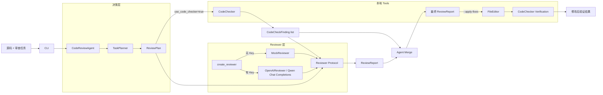
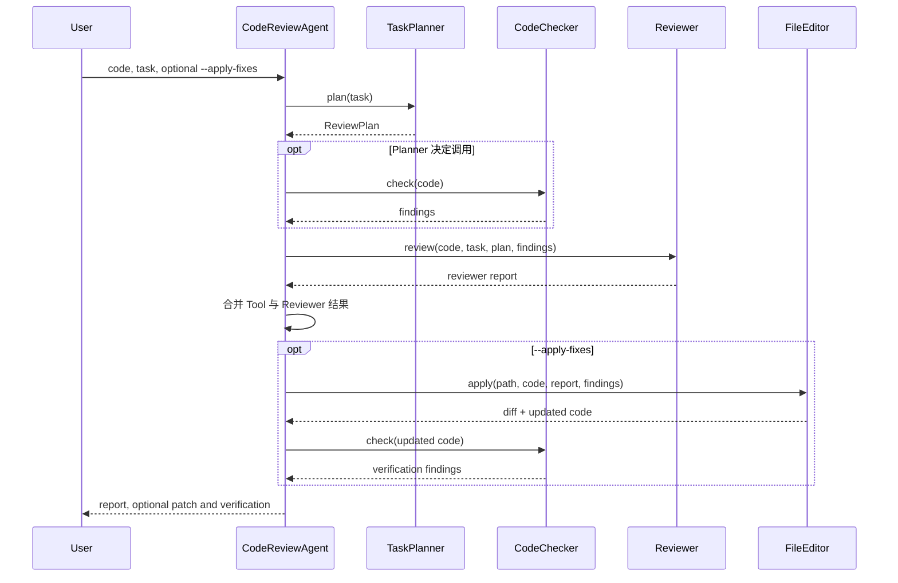

# Design: Python Code Review Agent

## 1. 目标

本项目演示一个最小但工程边界清晰的代码审查 Agent：

1. 接收 Python 源码和自然语言审查任务。
2. 由 Planner 决定是否需要本地静态工具。
3. 合并确定性 Tool 结果与可替换 Reviewer 结果。
4. 在用户显式授权时生成并应用保守补丁。
5. 修改后重新验证，形成可测试的闭环。
6. 无 API Key 时完整离线运行。

非目标：替代成熟 linter、执行不可信代码、自动修复所有问题，或在没有明确参数时修改文件。

## 2. 总体架构

核心设计原则是“确定性 Tool 结果不依赖 LLM”。CodeChecker 的发现由 Agent 直接转换成最终问题，Reviewer 只能补充，不能吞掉或覆盖这些结果。

## 3. 审查时序

## 4. 模块说明

| 模块 | 核心类型/入口 | 设计职责 |
| --- | --- | --- |
| `main.py` | `main()` | 解析 CLI、读取代码、控制是否写文件、统一错误输出和退出码 |
| `agent.py` | `CodeReviewAgent`, `ReviewRun`, `ReviewAndFixRun` | 单一编排入口，维持 Tool/Reviewer 独立性，合并结果并触发复检 |
| `planner.py` | `TaskPlanner`, `ReviewPlan` | 将任务文本映射为透明、确定性的 Tool 调用决策 |
| `code_checker.py` | `CodeChecker`, `CodeCheckFinding` | 仅使用 AST 的本地静态分析，不执行代码 |
| `file_editor.py` | `FileEditor`, `GeneratedPatch`, `FileEditResult` | 白名单式生成 diff、检查文件新鲜度、应用补丁 |
| `llm.py` | `Reviewer`, `MockReviewer`, `OpenAIReviewer`, `parse_review_report()` | 定义 Reviewer 边界，调用千问 OpenAI 兼容 Chat API，并将 JSON 校验为报告 |
| `prompt.py` | `SYSTEM_PROMPT`, `build_review_input()` | 将任务、Plan、源码和 Tool 结果组织成 LLM 上下文 |
| `models.py` | `ReviewIssue`, `ReviewReport` | 统一结构化输出和终端渲染 |
| `benchmarks/` | `BENCHMARK_CASES`, `run_benchmark()` | 确定性回归任务及 CI 退出码 |

## 5. Planner 决策

TaskPlanner 使用可解释关键词规则，而不是额外调用 LLM：

| 任务意图 | CodeChecker | 理由 |
| --- | --- | --- |
| 全面审查、语法、错误、异常、安全、正确性、可靠性 | 调用 | AST 可发现确定性运行问题 |
| 仅解释、总结、风格、命名、注释、文档、可读性 | 跳过 | 静态正确性检查与任务焦点无关 |
| 同时包含风险与风格 | 调用 | 风险意图优先，避免漏检 |
| 未知或模糊 | 调用 | 本地检查成本低，默认安全回退 |

`ReviewPlan` 会传递给 Reviewer，并写入最终摘要，便于测试和审计。

## 6. CodeChecker

CodeChecker 调用 `ast.parse()`，当前规则：

- `syntax-error`：捕获 `SyntaxError` 并转成 high 问题。
- `bare-except`：查找 `ast.ExceptHandler.type is None`。
- `division-by-zero`：检查 `/`、`//`、`%` 的右操作数是否为数字零常量，支持 `+0`、`-0.0`。

检查过程不导入、不编译、不执行被审查代码。规则输出包含 rule ID、行号、严重程度、原因和建议。

## 7. Reviewer 与 Mock 模式

`Reviewer` Protocol 隔离 Agent 与供应商实现。输入包括：

- 原始代码；
- 用户任务；
- Planner 决策；
- CodeChecker 结果（如果调用）。

`create_reviewer()` 根据 `.env` 自动路由：

- 缺少、为空或仍是占位 `DASHSCOPE_API_KEY`/`OPENAI_API_KEY`：`MockReviewer`；
- 有效配置：`OpenAIReviewer`，通过千问 OpenAI 兼容接口工作。

配置优先读取 `DASHSCOPE_API_KEY`、`DASHSCOPE_BASE_URL`、`QWEN_MODEL`，并兼容旧的 `OPENAI_API_KEY`、`OPENAI_BASE_URL`、`OPENAI_MODEL`。默认模型为 `qwen-plus`，默认地址为 `https://dashscope.aliyuncs.com/compatible-mode/v1`；生产环境可换成与 API Key 地域一致的工作空间专属地址。

Mock 返回固定结构化结果，用于验证整个 Agent 流程。真实 Reviewer 调用 `chat.completions.create()`，设置 `response_format={"type": "json_object"}` 和非思考模式，然后读取 `choices[0].message.content`。`parse_review_report()` 先解析纯 JSON 或 JSON 代码围栏，再使用 Pydantic 严格校验 `ReviewReport`；空响应、截断、拒答、非法 JSON 和 schema 错误均转换为 `LLMReviewError`。Agent 始终直接合并本地 Tool 发现，因此 LLM 不会成为确定性结果的单点故障。

## 8. FileEditor 安全模型

自动修改需要显式 `--apply-fixes`，并只支持 `.py` 文件。

当前修复白名单：

- `bare-except`：`except:` → `except Exception:`。

拒绝自动修复：

- 语法错误：缺少足够上下文推断作者意图；
- 常量除零：合法分母或业务分支未知；
- 不在最终审查报告中的发现；
- 行号或源码格式与预期不一致；
- 审查后内容已变化的文件。

FileEditor 使用 `difflib.unified_diff` 生成可审计补丁。发生实际写入后，Agent 强制再次运行 CodeChecker。没有安全补丁时不写文件，也不会声称问题已解决。

## 9. 异常与退出码

| 场景 | 行为 |
| --- | --- |
| 空输入、文件不存在、错误扩展名 | 可读错误，退出码 2 |
| `--apply-fixes` 未提供文件 | 拒绝修改，退出码 2 |
| 文件在审查后变化 | 拒绝过期补丁，退出码 2 |
| API 认证、限流、网络或状态错误 | 包装为 `LLMReviewError`，退出码 1 |
| Ctrl+C | 退出码 130 |
| 成功审查或无可自动修复项 | 退出码 0 |

## 10. Benchmark 设计

`benchmarks/cases.py` 用字符串保存代码，因此可以安全包含无法编译的语法错误案例。每个 `BenchmarkCase` 定义：

- 稳定 ID；
- 人类可读说明；
- Python 代码字符串；
- 有序的预期 rule ID。

Runner 对实际和预期序列做精确比较，打印每个任务的 PASS/FAIL，并在失败时返回退出码 1。当前包含 6 个问题案例和 1 个干净基线。

## 11. 测试策略与结果

测试均可离线执行，覆盖：

- Mock/千问 OpenAI 兼容 Reviewer 路由；
- Chat Completions 参数、纯 JSON、代码围栏 JSON、非法 JSON、schema 错误和截断响应；
- Planner 调用、跳过、混合和模糊意图；
- AST 语法、裸 `except`、三种零除及误报基线；
- Agent 的 Tool 传递和报告合并；
- FileEditor diff、实际写入、复检、危险修复跳过和过期补丁保护；
- Benchmark 案例数量与所有预期。

2026-10-03 在 Python 3.14.3 / Windows 上：

- `python -m unittest discover -s tests -v`：26 tests OK；
- `python -m benchmarks.run`：7/7 cases passed；
- `python -m compileall -q .`：通过；
- 可编辑安装和两个 console scripts：通过。

GitHub Actions 会在 Python 3.10、3.12 上重复编译、离线测试和 Benchmark。远程结果需在仓库首次 push 后确认。

## 12. 扩展点

- 在 `CodeChecker` 中增加更多 AST Visitor 规则。
- 用配置文件或分类器替换 Planner 关键词，但保持 `ReviewPlan` 接口。
- 新增其他 LLM 供应商，只需实现 `Reviewer` Protocol。
- 为 FileEditor 增加带规则 ID 的白名单修复器，避免自由文本直接驱动写入。
- 扩展 Benchmark 到性能、安全和误报/漏报数据集。
- 接入 Ruff、Bandit 或 mypy，并将结果标准化为 `CodeCheckFinding`。

## 13. 已知限制

- 规则集刻意保持最小，不能替代生产级静态分析器。
- Planner 依赖关键词，无法理解复杂隐含意图。
- Mock 输出固定，不评估输入代码的高层语义。
- FileEditor 不根据自由文本建议任意生成代码，这是为了控制自动写入风险。
- 真实 LLM 输出即使符合 schema，也仍可能存在判断错误。
