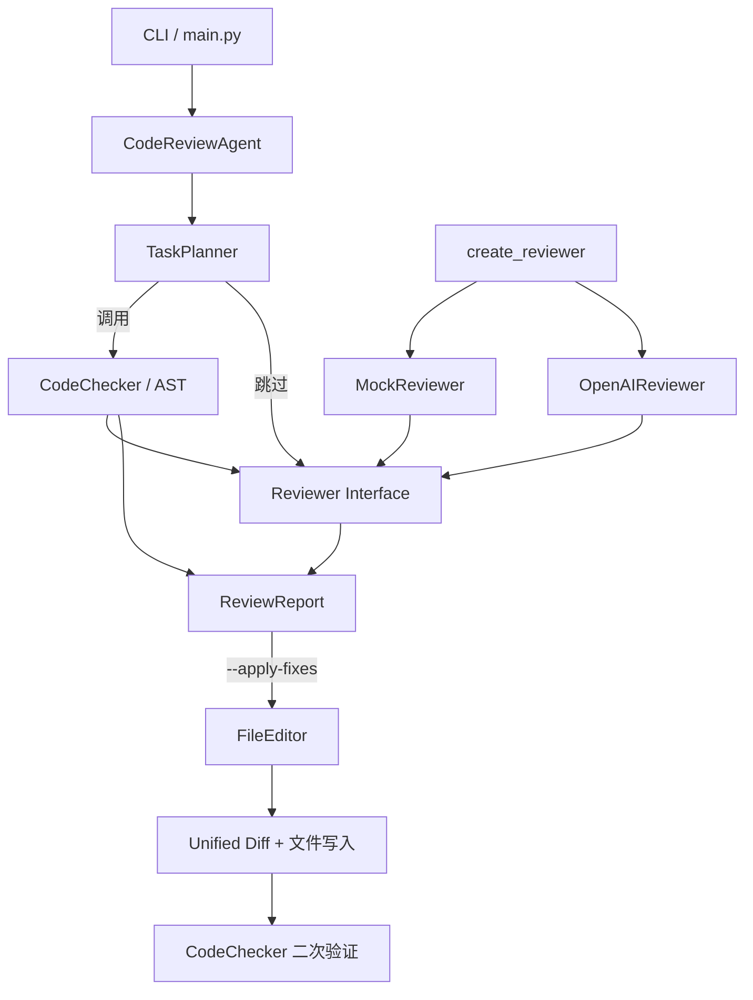

# Python Code Review Agent

一个可离线运行、可扩展的 Python 代码审查 Agent。它通过 Task Planner 决定是否调用本地 AST 工具，整理静态检查和 Reviewer 结果，并可生成安全补丁、修改文件后自动复检。

项目默认使用 `[MOCK MODE]`，不需要 API Key，也不会访问网络。配置 `OPENAI_API_KEY` 后会自动切换到真实 LLM Reviewer。

## 功能

- Task Planner 根据任务意图决定是否调用 `CodeChecker`。
- `CodeChecker` 使用 Python AST 检查语法错误、裸 `except` 和常量除零。
- Mock Reviewer 提供固定结构化结果，支持完全离线开发和测试。
- OpenAI Reviewer 使用结构化输出补充正确性、安全性、性能和可维护性问题。
- `FileEditor` 根据已确认的审查结果生成 unified diff，并应用保守的自动修复。
- 修改后自动重新运行 `CodeChecker`，报告剩余问题。
- 包含 7 个确定性 Benchmark 示例任务和 GitHub Actions CI 配置。

## Agent 架构



详细设计、决策边界和扩展点见 [Design.md](Design.md)。

## 模块说明

| 模块 | 职责 |
| --- | --- |
| `main.py` | CLI 参数、代码输入、模式提示、输出与顶层异常处理 |
| `agent.py` | 编排 Planner、Tools、Reviewer、报告合并和修复后验证 |
| `planner.py` | 根据任务意图生成 `ReviewPlan` |
| `code_checker.py` | 不执行代码的 AST 静态检查 Tool |
| `file_editor.py` | 从结构化审查结果生成并安全应用补丁 |
| `llm.py` | Reviewer 协议、Mock/OpenAI 实现及模式选择 |
| `prompt.py` | 真实 LLM 的系统提示和审查上下文 |
| `models.py` | 严重程度、问题和审查报告模型 |
| `benchmarks/` | Benchmark 案例、执行器和退出码 |
| `tests/` | Mock、Planner、CodeChecker、FileEditor 和 Benchmark 离线测试 |

## 环境要求

- Python 3.10 或更高版本
- OpenAI API Key（可选）

## 快速开始

### Windows PowerShell

```powershell
python -m venv .venv
.\.venv\Scripts\python.exe -m pip install -e .
.\.venv\Scripts\code-review-agent.exe --help
```

这里直接使用虚拟环境内的 Python 和 CLI 路径，不依赖 PowerShell 激活脚本或当前 `PATH`。安装完成后会在 `.venv\Scripts` 中生成 `code-review-agent.exe` 和 `code-review-benchmark.exe`。

### macOS / Linux

```bash
python3 -m venv .venv
.venv/bin/python -m pip install -e .
.venv/bin/code-review-agent --help
```

无需修改 `.env` 即可使用 Mock 模式。如需真实 LLM 审查：

```dotenv
OPENAI_API_KEY=sk-your-real-key
OPENAI_MODEL=gpt-4o-mini
```

`.env` 已加入 `.gitignore`，不要提交真实密钥。

如果已经激活虚拟环境，也可以直接使用命令名：

```powershell
code-review-agent --help
code-review-benchmark
```

Windows PowerShell 中若未激活虚拟环境，裸命令不会自动搜索当前项目的 `.venv\Scripts`；此时应优先使用 `.\.venv\Scripts\code-review-agent.exe` 的显式路径。

## 运行示例

### 1. 粘贴代码

```powershell
python main.py
```

粘贴代码后单独输入 `END`：

```text
value = 10 / 0
END
```

### 2. 审查 Python 文件

```powershell
python main.py example.py
```

### 3. 指定任务，让 Planner 自主路由

```powershell
# 全面审查：调用 CodeChecker
python main.py example.py --task "全面审查正确性和安全性"

# 仅风格和命名：跳过 CodeChecker
python main.py example.py --task "只检查代码风格和命名"
```

Planner 的当前规则：

- 全面审查，或涉及语法、错误、异常、安全、正确性、可靠性：调用 CodeChecker。
- 仅解释、总结、风格、格式、命名、注释、文档或可读性：跳过 CodeChecker。
- 同时包含风险和风格意图：优先调用 CodeChecker。
- 意图不明确：默认调用低成本静态检查，减少漏检。

### 4. 生成并应用安全补丁

```powershell
python main.py example.py --apply-fixes
```

示例输出片段：

```diff
--- example.py
+++ example.py
@@
-except:
+except Exception:
```

只有显式提供 `--apply-fixes` 才会写入文件。当前自动修复范围是裸 `except`；语法错误和除零问题会说明无法安全自动修复的原因，不会擅自改写业务逻辑。写入前会检查文件是否在审查后发生变化，修改后会自动重新运行 CodeChecker。

## CodeChecker 规则

| Rule ID | 检查内容 | 严重程度 | 自动修复 |
| --- | --- | --- | --- |
| `syntax-error` | Python AST 无法解析 | high | 否，需要理解代码意图 |
| `bare-except` | `except:` 捕获范围过宽 | medium | 是，改为 `except Exception:` |
| `division-by-zero` | `/ 0`、`// 0`、`% 0`，含正负零常量 | high | 否，避免改变业务语义 |

## Benchmark 示例任务

运行：

```powershell
python -m benchmarks.run
```

| Case | 示例问题 | 预期规则 |
| --- | --- | --- |
| `syntax_error` | 函数定义语法错误 | `syntax-error` |
| `bare_except` | 裸 `except` | `bare-except` |
| `true_division_zero` | `/ 0` | `division-by-zero` |
| `floor_division_zero` | `// -0.0` | `division-by-zero` |
| `modulo_zero` | `% +0` | `division-by-zero` |
| `multiple_findings` | 同时包含零除和裸 `except` | 两条对应规则 |
| `clean_baseline` | 合法异常处理和动态分母检查 | 无问题 |

Benchmark 是确定性本地评测，不调用 LLM。任何预期与实际不一致都会返回非零退出码，适合 CI 使用。

## 测试与验证结果

离线测试：

```powershell
python -m unittest discover -s tests -v
```

完整本地验证命令：

```powershell
.\.venv\Scripts\python.exe -m compileall -q .
.\.venv\Scripts\python.exe -m unittest discover -s tests -v
.\.venv\Scripts\python.exe -m benchmarks.run
.\.venv\Scripts\code-review-agent.exe --help
```

2026-09-26 本地验证结果：

| 检查 | 环境 | 结果 |
| --- | --- | --- |
| 源码编译 | Python 3.14.3 / Windows | 通过 |
| 离线单元测试 | Python 3.14.3 / Windows | `19 tests OK` |
| CodeChecker Benchmark | Python 3.14.3 / Windows | `7/7 cases passed` |
| `pip install -e .` | setuptools 84.0.0 | 通过 |
| `code-review-agent --help` | 安装后的 CLI 入口 | 通过 |
| `code-review-benchmark` | 安装后的 Benchmark 入口 | `7/7 cases passed` |

GitHub Actions 已配置在 `.github/workflows/ci.yml`：Linux 会在 Python 3.10 和 3.12 上执行编译、测试和 Benchmark，Windows 会在独立虚拟环境中安装项目，并分别通过虚拟环境路径和 `PATH` 调用 CLI 入口。远程 CI 状态需在首次 push 后确认。

## 项目结构

```text
.
├── .github/workflows/ci.yml
├── benchmarks/
│   ├── __init__.py
│   ├── cases.py
│   └── run.py
├── tests/
│   ├── test_benchmark.py
│   └── test_offline.py
├── agent.py
├── code_checker.py
├── file_editor.py
├── llm.py
├── main.py
├── models.py
├── planner.py
├── prompt.py
├── Design.md
├── pyproject.toml
├── requirements.txt
├── .env.example
└── README.md
```

## GitHub 提交前检查

```powershell
.\.venv\Scripts\python.exe -m unittest discover -s tests -v
.\.venv\Scripts\python.exe -m benchmarks.run
git status
git add .
git commit -m "feat: add Python code review agent"
```

当前目录尚未初始化 Git 仓库。如需新建仓库，请先运行 `git init`，再执行上述提交命令。提交前确认 `.env`、`.venv`、缓存和构建产物未被跟踪。

## 安全与限制

- CodeChecker 只解析 AST，不执行用户代码。
- Mock 模式不会访问网络。
- 真实 LLM 模式会将代码发送到配置的 API 服务，不要提交密钥、个人信息或敏感代码。
- Planner 是透明的关键词路由器，不是通用任务规划模型。
- CodeChecker 仅覆盖少量高确定性规则，不替代 Ruff、Pylint、Bandit、mypy 或人工审查。
- FileEditor 只应用白名单式修复；其余问题保留给开发者判断。
