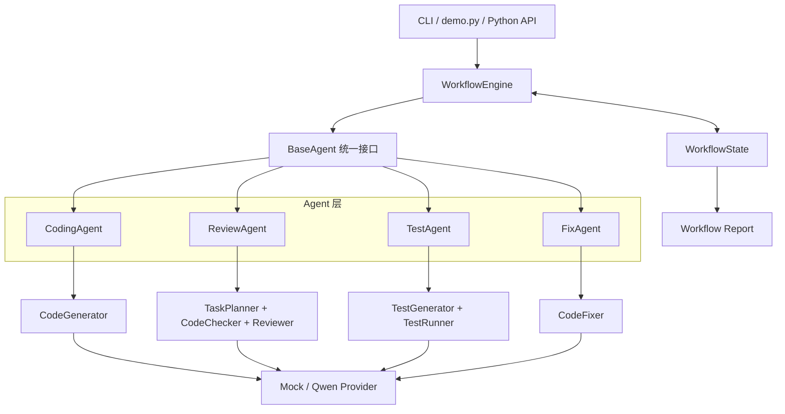
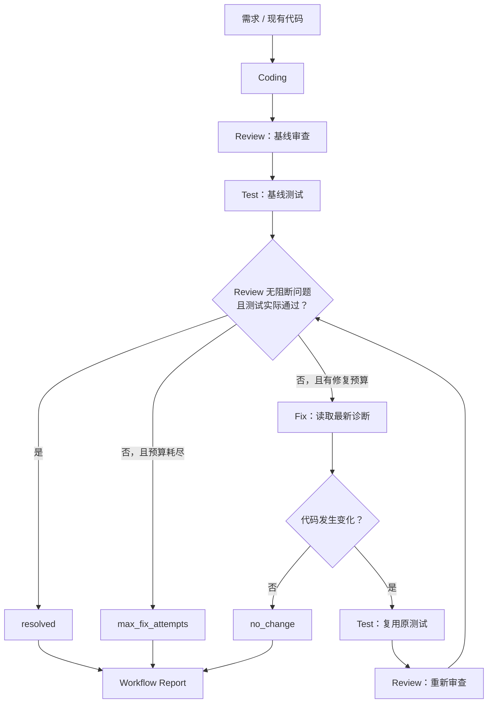

# Homework1：Multi-Agent Code Review Workflow

一个面向 Python 的多 Agent 代码生成、审查、测试与自动修复项目。项目以统一的 Agent 接口和可观测的 `WorkflowState` 为核心，将 Coding、Review、Test、Fix 串成带条件分支和有限循环的完整闭环，并生成可序列化的最终报告。

项目既可完全离线运行，也可通过 OpenAI 兼容接口接入 Qwen。根目录的 `demo.py` 提供无需 API Key、结果可复现的端到端演示。

## 功能概览

- **统一 Agent 抽象**：`CodingAgent`、`ReviewAgent`、`TestAgent`、`FixAgent` 均继承 `BaseAgent`。
- **状态驱动执行**：Agent 只读取 `StateView` 并返回 `AgentResult`，由 Workflow 原子提交状态更新。
- **条件分支与有限循环**：根据 Review 和 Test 结果决定结束、测试、修复或继续复验。
- **真实测试执行**：自动生成 `unittest` 用例，并在带超时的独立 Python 子进程中运行。
- **完整可观测性**：保存阶段状态、Agent 结果、测试历史、修复历史、迭代次数和结构化日志。
- **最终 Workflow Report**：汇总业务结果、阶段记录、测试结果、修复轮次和执行日志，并支持 JSON 序列化。
- **离线与真实模型双模式**：无 Key 时使用确定性 Mock；配置 Key 后使用 Qwen OpenAI 兼容服务。

更详细的设计取舍见 [Design.md](Design.md)。

## 系统架构



`WorkflowEngine` 负责调度、路由、状态提交和异常处理；Agent 负责单一领域任务；模型供应商通过协议与 Agent 解耦。本地 `CodeChecker` 和 `TestRunner` 不依赖远程模型。

## Agent 闭环

### 统一接口

`BaseAgent` 使用模板方法统一校验输入输出：

```python
result = agent.execute(state_view)
# result: AgentResult(updates={...}, output=...)
```

每个子类只需实现 `run(state)`。第三方 Agent 也可直接实现包含 `name` 和 `execute(StateView) -> AgentResult` 的结构化接口。

| Agent | 核心职责 | 主要输入 | 主要输出 |
| --- | --- | --- | --- |
| `CodingAgent` | 根据需求生成并校验 Python 代码 | `requirements`、`context` | `code`、`generation_result` |
| `ReviewAgent` | 合并任务规划、AST 检查、模型审查和测试证据 | `code`、`task`、测试结果 | `report`、`plan`、`tool_findings` |
| `TestAgent` | 生成或复用测试，并执行真实子进程测试 | `code`、需求、原测试用例 | `test_cases`、`test_result` |
| `FixAgent` | 根据 Review/Test 反馈修改代码并生成 diff | `code`、`report`、`test_result` | 新 `code`、`fix_result`、`fix_changed` |

### 完整工作流程



闭环遵循以下规则：

1. 先完成基线 Review 和 Test，避免只凭单一信号判断成功。
2. 仅当 Review 没有阻断问题，且 Test 实际执行并通过时，结果才是 `resolved`。
3. 代码变化后必须复用原测试用例重新测试，再重新 Review。
4. Fix 没有产生变化时以 `no_change` 提前停止，避免无效循环。
5. 达到 `max_fix_attempts` 后以 `unresolved` 正常结束；Agent 异常则标记为 `failed`。
6. `max_steps` 提供通用执行上限，防止错误路由造成无限循环。

单轮模式同样支持 `coding → review → test → fix → verify`，但不会继续消耗新的修复轮次。

## Workflow State 与报告

`WorkflowState` 同时保存业务数据和运行元数据。Engine 每次只提交一个 Agent 返回的完整更新，并递增 State 版本；Agent 异常时不会提交未完成结果。

| 分类 | 代表内容 |
| --- | --- |
| 阶段状态 | `pending`、`running`、`completed`、`failed`，以及每次调用的耗时和错误 |
| Agent 结果 | Agent、阶段、迭代、修复轮次、输出和更新字段 |
| 测试记录 | 全部 `TestExecutionResult` 及最新测试结果 |
| 修复历史 | 修复前后代码、Review/Test 快照、diff、轮次状态和步骤耗时 |
| 迭代信息 | Workflow 总阶段次数、当前修复次数、最大修复预算 |
| 执行日志 | 有序事件、时间、级别、State 版本、阶段、Agent 和修复轮次 |

循环阶段不会覆盖历史记录。基线日志使用修复轮次 `0`，实际修复从 `1` 开始，可通过 `state.logs_for_round(n)` 查询单轮日志。

终态可通过 `run.report` 获得 `WorkflowReport`：

- `outcome`：`succeeded`、`unresolved` 或 `failed`；
- 各阶段的状态、执行次数、累计耗时和调用记录；
- 全部 Agent 结果、测试结果、修复历史与执行日志；
- 最终 Review/Test 结果、总迭代次数和修复轮数；
- `to_dict()`：生成 JSON 兼容字典。

若 Workflow 抛出 `WorkflowExecutionError`，仍可对异常中的终态 State 调用 `generate_workflow_report(state)` 生成失败报告。

## Demo：完整闭环演示

`demo.py` 使用现有 Workflow 和四个真实 Agent 类，只替换为确定性的离线供应商。场景故意经历两轮修复：

```text
错误减法 → 第一轮修复仍多加 1 → 第二轮修复正确 → 3/3 测试通过
```

Demo 会按清晰的 CLI 分区输出：

1. Agent 执行过程与 State 更新字段；
2. Review/Test 条件判断和下一节点；
3. 每轮修复状态及各步骤耗时；
4. 按轮次组织的结构化执行日志；
5. 最终 Workflow Report 和最终代码。

Windows PowerShell：

```powershell
.\.venv\Scripts\python.exe demo.py
.\.venv\Scripts\python.exe demo.py --json
```

macOS / Linux：

```bash
.venv/bin/python demo.py
.venv/bin/python demo.py --json
```

可用参数：

| 参数 | 说明 |
| --- | --- |
| `--max-fix-attempts N` | 设置最大修复次数；默认 `3`，演示正常收敛需要 `2` 次 |
| `--json` | 在人类可读结果后附加完整 Report JSON |

退出码 `0` 表示成功，`1` 表示未解决或执行失败。可编辑安装后也可使用 `homework2-demo` 命令。

## 安装与配置

项目要求 Python 3.10 或更高版本。

### Windows PowerShell

```powershell
python -m venv .venv
.\.venv\Scripts\python.exe -m pip install -e .
.\.venv\Scripts\python.exe main.py --help
```

### macOS / Linux

```bash
python3 -m venv .venv
.venv/bin/python -m pip install -e .
.venv/bin/python main.py --help
```

安装后提供以下命令：

- `code-review-agent`
- `code-review-benchmark`
- `homework2-demo`

### 模型配置

不配置 API Key 时自动使用离线 Mock。接入 Qwen 时，在本地 `.env` 中设置：

```dotenv
DASHSCOPE_API_KEY=your_api_key_here
DASHSCOPE_BASE_URL=https://dashscope.aliyuncs.com/compatible-mode/v1
QWEN_MODEL=qwen-plus
```

项目也兼容 `OPENAI_API_KEY`、`OPENAI_BASE_URL` 和 `OPENAI_MODEL`。`.env` 不应提交到 Git；默认模板见 [.env.example](.env.example)。

> **Mock 模式说明**：Mock 用于验证流程与接口，不保证实现任意业务需求。`MockTestGenerator` 只执行模块导入冒烟测试，`MockCodeFixer` 仅处理有限的安全改写。需要业务级结果时，应使用真实供应商或 `demo.py` 中的确定性场景。

## 使用方式

以下示例使用 Windows 虚拟环境路径；macOS / Linux 将解释器替换为 `.venv/bin/python`。

### 审查现有代码

```powershell
.\.venv\Scripts\python.exe main.py example.py
.\.venv\Scripts\python.exe main.py example.py --task "检查正确性和异常处理"
```

省略文件路径时进入终端粘贴模式，以单独一行 `END` 结束输入。

使用 `--apply-fixes` 可对支持的本地问题应用保守修复，并在写入前检查文件是否已变化：

```powershell
.\.venv\Scripts\python.exe main.py example.py --apply-fixes
```

### 生成、测试与修复

```powershell
# 生成并审查
.\.venv\Scripts\python.exe main.py --requirements "实现 add(a, b)，返回两数之和"

# 生成、审查并测试
.\.venv\Scripts\python.exe main.py --requirements "实现 add(a, b)，返回两数之和" --run-tests

# 单轮修复与复验
.\.venv\Scripts\python.exe main.py --requirements "实现 add(a, b)，返回两数之和" --run-tests --fix-code

# 最多自动修复 3 次
.\.venv\Scripts\python.exe main.py --requirements "实现 add(a, b)，返回两数之和" --run-tests --fix-code --max-fix-attempts 3
```

参数约束：

- `--context` 必须与 `--requirements` 一起使用；
- `--run-tests` 和 `--fix-code` 仅用于生成流程；
- `--max-fix-attempts` 必须是非负整数，并与 `--run-tests --fix-code` 一起使用；
- `--test-timeout` 设置测试子进程超时，默认 10 秒；
- `--apply-fixes` 仅用于传入的 `.py` 文件。

主 CLI 的退出码为：成功 `0`，Workflow/模型失败或结果未通过 `1`，参数错误 `2`，用户中断 `130`。

## Python API

以下代码组装完整自动修复循环：

```python
from agent import ReviewAgent
from coding_agent import CodingAgent, create_coding_workflow
from fix_agent import FixAgent
from llm import (
    create_code_fixer,
    create_code_generator,
    create_reviewer,
    create_test_generator,
)
from test_agent import TestAgent

workflow = create_coding_workflow(
    CodingAgent(create_code_generator()),
    ReviewAgent(create_reviewer()),
    test_agent=TestAgent(create_test_generator()),
    fix_agent=FixAgent(create_code_fixer()),
    max_fix_attempts=3,
)

run = workflow.run({
    "requirements": "实现 add(a, b)，返回两数之和",
    "context": "仅使用 Python 标准库",
})

print(run.state.require("code", str))
print(run.report.summary)
print(run.report.to_dict())
```

主要工厂函数：

| 工厂 | 用途 |
| --- | --- |
| `create_review_workflow(...)` | 审查 State 中的现有代码 |
| `create_coding_workflow(...)` | 组合代码生成及可选 Review/Test/Fix 节点 |
| `create_test_workflow(...)` | 测试 State 中的现有代码 |
| `create_fix_workflow(...)` | 对已有诊断执行单次修复 |
| `create_repair_workflow(...)` | 对已有代码运行有限自动修复循环 |

## 测试与验证

本地离线回归结果：

| 检查项 | 结果 |
| --- | --- |
| 单元测试 | `145 tests OK` |
| CodeChecker Benchmark | `7/7 cases passed` |
| Python 源码编译 | 通过 |
| Demo 完整闭环 | 两轮修复后 `3/3` 测试通过，Report 为 `succeeded` |

复现命令：

```powershell
.\.venv\Scripts\python.exe -m unittest discover -s tests -v
.\.venv\Scripts\python.exe -m benchmarks.run
.\.venv\Scripts\python.exe -m compileall -q agent.py coding_agent.py demo.py fix_agent.py llm.py main.py models.py planner.py prompt.py review_policy.py test_agent.py test_feedback.py test_worker.py workflow tests
.\.venv\Scripts\python.exe demo.py
```

测试覆盖 Agent 输入输出、State 版本与快照、条件路由、循环上限、测试子进程、失败证据、修复语法重试、Review 范围策略、Workflow Report 和 CLI 行为。GitHub Actions 配置位于 [.github/workflows/ci.yml](.github/workflows/ci.yml)。

## 项目结构

```text
.
├── workflow/
│   ├── agent.py             # Agent Protocol、BaseAgent、AgentResult
│   ├── engine.py            # Workflow 步骤、路由和执行器
│   ├── state.py             # State、阶段记录和执行日志
│   ├── repair.py            # 条件分支和有限修复循环
│   └── report.py            # 最终 Workflow Report
├── tests/                   # 145 项离线回归测试
├── benchmarks/              # 7 个确定性 CodeChecker 案例
├── agent.py                 # ReviewAgent
├── coding_agent.py          # CodingAgent 与组合工厂
├── test_agent.py            # TestAgent 与 TestRunner
├── fix_agent.py             # FixAgent 与 FixRun
├── llm.py                   # Provider 协议、Mock 与 Qwen 实现
├── models.py                # Pydantic 业务模型
├── code_checker.py          # AST 静态检查
├── review_policy.py         # Review 范围与评分策略
├── test_feedback.py         # 测试失败证据提取
├── main.py                  # 主 CLI
├── demo.py                  # 确定性完整闭环演示
├── Design.md                # 详细设计文档
└── pyproject.toml           # 依赖、打包与命令入口
```

## 工程边界与安全说明

- 当前 Workflow 处理单份 Python 源码，不生成多文件工程。
- `CodeChecker` 只覆盖少量高确定性 AST 规则，不能替代完整静态分析与人工审查。
- `TestRunner` 使用临时目录、精简环境、独立进程和超时，但不是操作系统安全沙箱；不要执行不可信代码。
- Test Agent 不自动安装第三方依赖，被测代码所需依赖必须已存在。
- 真实模型模式会将需求、代码和诊断发送到配置的服务，请遵守相应的数据处理要求。
- 自动循环保证次数有界，但不保证所有问题都能自动修复。
- State 与日志当前保存在进程内，不支持持久化恢复或分布式执行。

## Homework1 提交检查

- [x] 四个 Agent 统一继承 `BaseAgent`
- [x] Workflow 支持条件分支和有限循环
- [x] State 保存阶段、Agent、测试、修复、迭代和日志信息
- [x] 最终 Workflow Report 支持结构化输出与 JSON 序列化
- [x] `demo.py` 可离线展示完整闭环
- [x] 145 项测试全部通过
- [x] Benchmark 7/7 通过
